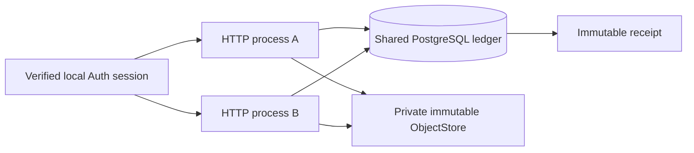

# G3A.1 shared upload authority

Issue #8 replaces the single-host upload ledger for the explicitly selected
shared HTTP application. PostgreSQL owns admission, cumulative quota, immutable
request identity, leases/fences and receipts. The historical SQLite authority
and every G0/G1/G2/G3A file remain unchanged for regression. The 114-file
`G3A1_BASELINE_SHA256SUMS.txt` records the merged main
`7a271382487ac4d16e278e5ccb8c345279b3cc16`.

## Components and trust

`SharedMediaHTTPApplication` requires `PostgresUploadAuthority` using the same
restricted, nonowner, NOINHERIT API login. It rejects a SQLite authority,
privileged login or mismatched DSN. Use `shared_http_server(application)` for
the bounded loopback transport, including the new binary resume route. Each
replica creates its own authority, connection semaphore, HTTP server and working
directory; only PostgreSQL, compatible private storage and a server-owned
signing key are shared. There is no process-local grant/receipt database or
automatic SQLite fallback.

Authentication still uses the historical verifier and current session check.
The local official Auth integration uses independently issued GoTrue tokens
and PostgreSQL session lookup, including logout and deleted users. User
metadata, organization headers and service-role tokens confer no authority.
The HTTP login cannot provision quotas, write tables or use the separately
restricted service reconciliation functions. See [G3A1_SCHEMA.md](G3A1_SCHEMA.md)
for roles, RLS, constraints and SQL lock order.

## Requests and immutable publication

| Operation | Contract |
| --- | --- |
| `POST /v1/orgs/{org}/uploads` | JSON `request_key`, `size_bytes`, `sha256`; shared admission returns the stable grant and PUT capability. |
| `PUT /v1/uploads/{capability}` | Authenticated owner; exact bounded bytes/hash, current membership, original grant expiry and fenced claim required. |
| `GET /v1/orgs/{org}/uploads/{id}` | Owner-scoped reconciliation and verified receipt; a receipt alone never bypasses actual object verification. |
| `POST /v1/orgs/{org}/uploads/{id}/reconcile` | Bounded recovery with a new fence after the old lease expires. |
| `POST /v1/orgs/{org}/uploads/{id}/resume` | Fresh owner session and exact original bytes; permits an already claimed operation to resume after its original expiry, without a second charge. |
| `GET /v1/orgs/{org}/uploads/metrics` | Authorized organization counters, states/backlog and reconciliation events. |

Changed owner/body/hash for a reused key conflicts. Expired keys remain
tombstones. Successful responses use `uploaded_pending_validation`: these
private bytes are not automatically promoted into a verified G2 media asset.
The historical render/status/private-download routes are delegated unchanged;
the official Auth suite proves an actual FFmpeg render through that boundary.

Publication commits a claim before storage I/O, writes only the admitted
organization/key through immutable create-if-absent storage, reads actual
stored bytes and verifies hash, size and available generation, then commits
one receipt. ObjectStore and PostgreSQL do not share an atomic transaction.
Errors after claim conservatively retain quota and mark the attempt uncertain
when possible. A lost response after commit replays the existing receipt.
An older fence cannot replace it.

Membership checks run in each short SQL transaction; no outer membership
transaction spans storage I/O or waits on nested authority transactions.
Revocation during publication can deny completion. Any resulting private
object remains charged and recoverable by the restricted reconciliation role.

## Bounds, clocks and observability

Database limits, not replica configuration, cap organization bytes/count,
per-upload size, TTL and lease. PostgreSQL time controls expiry and fences.
Heartbeat scheduling uses the lease duration actually granted by PostgreSQL.
The operation deadline is derived from a returned database timestamp; SQL
heartbeat and completion wrappers check it after membership/quota/reservation
locks, so completion is rejected if its deadline elapsed during a lock wait.
The remaining budget also bounds SQL statement execution. Renewal cannot
extend beyond that deadline. This controls receipt admission; it does not
promise a hard real-time bound on COMMIT/fsync acknowledgement. A newer attempt must acquire its
own fence and verify the same immutable object.

The Python operation budget bounds renewal and receipt authorization; Python
cannot forcibly cancel an arbitrary blocking ObjectStore implementation.
A supervisor must terminate a stuck process for a hard I/O wall-time bound.
The SQL statement, lock, connection and transaction timeouts remain bounded.
The HTTP server retains body, handler and receive-deadline limits. No claim
of a production supervisor or remote storage timeout validation is made.

Upload database connections are limited per authority and share that budget
with heartbeat transactions. Session lookup and inherited render handling have
separate historical budgets. Admission overload returns explicit backpressure;
benchmarks count physical retries rather than hide them. Counters include
retained reservation bytes/count and state/reconciliation backlog; audit rows
contain identifiers and event codes, never JWTs or capabilities. HTTP errors
are generic and do not return database exception details. Operators must avoid
logging authorization headers, capability URLs, DSNs or signing keys.

## Scope of evidence

The real integration target is PostgreSQL 16.15 plus private local disk and
official local GoTrue, with two independent OS HTTP processes and a newly
started third process. This establishes process/restart independence on one
host with compatible storage. It does not establish cross-host filesystem
semantics, cloud autoscaling, hosted Auth, remote OIDC, GCS/R2/S3, Cloud Tasks,
Cloud Run or monetary costs. Those remain **NOT_VALIDATED**; costs are
**UNKNOWN**. G3B remains unexecuted and requires its existing separate plan
and authorization. No cloud image/deploy switch is enabled by this change.

See [G3A1_RUNBOOK.md](G3A1_RUNBOOK.md) for retention and rollback,
[G3A1_BENCHMARK.md](G3A1_BENCHMARK.md) for measurement boundaries, and
[G3A1_DECISION.md](G3A1_DECISION.md) for the evidence-backed gate result.
