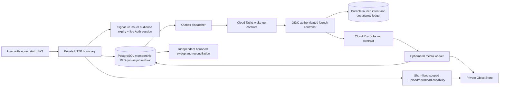

# ADR G3A: private control plane, disposable compute, durable PostgreSQL authority

Status: proposed topology; local evidence and remote validation are separate.
Baseline: main `366f0f01b9c9d349ea9270d4051779deecd105c9`, after G2 merge.
All 61 baseline files are preserved by `G3A_BASELINE_SHA256SUMS.txt`. G0/G1/G2
remain runnable independently; G3A adds files rather than changing their contracts.

## Decision and alternatives

| Layer | Primary candidate | Lower complexity/cost alternative | Decision boundary |
|---|---|---|---|
| Identity/data | Supabase Auth + PostgreSQL RLS | Official GoTrue + managed/self-hosted PostgreSQL | Local official Auth is testable without a hosted project; hosted security/operations/pricing remain unvalidated. |
| Object storage | Private Google Cloud Storage | Local persistent store; R2/S3 behind the same protocol | GCS co-location can avoid inter-cloud transfer; R2's egress policy does not remove GCP outbound charges. Select only after measured total cost. |
| Scheduling | Cloud Tasks as a short wake-up signal | PostgreSQL polling/sweep without a queue | PostgreSQL is always authoritative. For low volume, polling alone can avoid queue/IAM complexity. Provider dedup/history is temporary. |
| Compute | Cloud Run Jobs, one bounded render per execution | A bounded CPU worker on one private VM | Ephemeral Jobs avoid a permanent render fleet but add startup/IAM uncertainty. VM utilization and operational cost must be compared with real workloads. |
| Web boundary | Minimal authenticated API, separate from render | Local loopback HTTP for this gate | No FFmpeg in HTTP request handlers; an audited production HTTP runtime/TLS/rate limiter remains a G3B prerequisite. |
| IaC | Reviewable Terraform JSON | Explicit manual staging checklist | Declarative files are not applied. Static checks and actual local provider schema validation are separate from deployed IAM behavior. |

No vendor is approved for production by G3A. Kubernetes, GPU, social APIs,
payment systems and AI add no value to this validation and are excluded.

## Trust and data flow

User identity comes only from a cryptographically verified JWT with configured
trust roots, exact issuer/audience, time checks, authenticated role and a live
`auth.sessions` match. Client-controlled metadata, headers, key URLs and organization
claims never establish membership. Membership and permission are read from the
database for each request; SQL submission rechecks membership through commit.
Signed-out sessions are rejected on subsequent requests even while their access
JWT has not expired. Already admitted in-flight requests are not retroactively
cancelled by logout; transaction/lease boundaries govern their state.

The web login owns no application table, cannot bypass RLS, cannot assume the
worker role and is restricted to the authenticated execution context. Session
lookups use a narrowly granted internal reader role. Authentication DB failures
fail closed. The trusted G2 fixture/importer remains separate: uploads do not
become verified media assets merely because a client supplies metadata or SHA.
Uploaded bytes require a separate validation/ingestion worker before render
submission; HTTP never probes/decodes media or receives a privileged ingest DSN.

## Async execution and uncertainty

Cloud Tasks names use the stable outbox event ID. A lookup miss is not proof
that a task was never accepted; history/name retention expires (up to 24 hours
for the documented name window). Recreated wake-up signals are safe only because
the PostgreSQL job, unique request, quotas and fenced lease remain authoritative.
The G3A adapter does not inherit G1's stronger authoritative-lookup assumption.

Calling Cloud Run Jobs `run` is not an idempotent physical render operation.
Before that call, the controller commits an immutable per-job/fence launch token.
Lost responses or a crash leave an uncertain launch record. It does not blindly
call `run` again. Reconciliation uses the stored operation where known, worker
claims and durable PostgreSQL state; unresolved uncertainty requires operator
review. A global admission limit counts unresolved launch records, so uncertainty
can reduce availability rather than multiply compute cost. Per-execution task
count and Cloud Tasks HTTP concurrency do not impose a global execution cap.
Even a completed PostgreSQL job does not prove its provider execution stopped:
the reservation is retained until an authenticated provider execution GET shows
terminal task counters and completion time. An operation marked done alone is
insufficient. These provider semantics/IAM are only locally tested contracts.

Only the bound worker may consume the launch intent, and it rechecks identity,
job/organization/fence and G1 quotas before rendering. G1/G2 leases and fencing
protect authoritative manifests. Exactly-once physical execution is not promised.
The unchanged G2 sweep remains a local recovery implementation. In staging it
must not start cloud workers outside launch admission or free an unresolved
physical slot: a logical PostgreSQL retry is not permission to create another
provider execution. Route every staging wake-up/retry through the launch ledger
and terminal-execution reconciliation, with IAM denying direct bypass.
`LaunchController.sweep_once(limit)` implements that cloud-safe path: rotating
bounded launch observations, due PostgreSQL media/outbox discovery independent of
task history, and all launches through the same admission transaction. Unknown
physical executions remain blocked; a later fence for the same job is forbidden
until the previous physical reservation is closed. Exhausted attempts are
terminalized only when no physical reservation or live lease remains.
Direct GCS/Tasks/Run calls remain NOT_VALIDATED until separately authorized G3B.

## Storage and retention

Storage keys retain organization/job/fence prefixes. GCS publication requires
create-only generation preconditions; deletion matches a specific generation.
An accepted-but-lost upload is reconciled by metadata and actual byte hash,
not by blindly overwriting. Resumable session URLs are internal bearer secrets:
only a fixed provider endpoint and validated session origin are accepted. No
public ACL or public bucket is required. Temporary HTTP capabilities bind user,
organization, key, method, expiry, size and hash; they reauthenticate/recheck
membership when used and have durable reservation limits.

Those upload reservations/receipts are durable only on the tested single-host
SQLite file/volume. **Cloud API multi-replica and ephemeral upload-state
persistence are BLOCKED** until a shared PostgreSQL reservation/receipt backend
is implemented and tested. Do not enable the proposed API images or infer a
distributed storage quota from this local ledger. G1 render reservations and
G3 launch admission are separate PostgreSQL authorities.

Outputs are accepted only after real SHA/size/probe checks and fenced DB commit.
Orphan inventory is scoped to obsolete generations, with conditional deletion;
live/current authoritative generations are protected. Input ingestion orphans
remain report-only until ingestion drains. Proposed staging TTLs are not a legal
retention policy: data residency, backups, deletion requests, object versions,
legal hold and customer retention require separate approval before customer data.

## Connections, limits and failure response

- HTTP has bounded bodies, request/socket timeout, maximum handlers and a bounded
  database semaphore. No unbounded per-request pool or render subprocess exists.
- Benchmark workers have an explicit process/thread cap and per-org active quota.
  The launch ledger adds global admission serialization in PostgreSQL; every
  cloud launch must use it. IAM must prevent bypassing the controller.
- Long renders must not hold an HTTP connection or a transaction open. Lease
  heartbeats use short transactions. Session-reader connections are separate,
  bounded requests; staging needs a real total connection budget including Auth,
  web, dispatcher, worker heartbeats, sweeper, administration and headroom.
- Provider 429/timeouts use bounded backoff. Queue failures retain outbox state;
  storage uncertainty preserves objects for verification; run uncertainty blocks
  relaunch. Broken Auth/DB fails closed rather than accepting stale credentials.
- Provider outage needs queue-age/backlog and unresolved-launch alarms, bounded
  ingress reservations, operator ownership and a documented drain/reconcile path.

## Observability and rollback

Use organization/job/event/fence/launch correlation IDs without JWTs, capability
URLs, session secrets, signed URLs, passwords or media contents in telemetry.
Metrics: admission rejections, request latency, DB wait/connection pressure,
outbox age/retries, uncertain launches, lease expiry/renewal, per-org active count,
render duration, bytes, object verification failures, orphan age/size and measured
CPU/RSS. Percentiles in local reports describe that local cohort only.

Rollback of G3A is closing its DRAFT PR and removing the disposable local stack.
No resources have been created remotely and no production migration exists.
Staging rollback must first stop new admissions, preserve authoritative DB/object
state, drain or cancel bounded executions, reconcile uncertainty, retain audit
evidence and only then remove the isolated staging resources. Never reset G0/G1/G2
or Creative OS as a rollback action.

## License and native parser gate

The observed FFmpeg binary is GPL-enabled with libx264/libass. A permissive
license in an upstream repository does not authorize codec patents, bundled
native dependencies, model weights or a binary redistribution. G3A does not
clear commercial distribution. A release needs exact image/binary digests, SBOM,
LICENSE/NOTICE/source obligations, transitive licenses, vulnerability and codec
review. G2's rlimits/process supervision remain useful but do not constitute
production hostile-media isolation, seccomp or fuzz coverage. Until those gates
are signed off, only synthetic media is authorized.

References: Supabase Auth/RLS and changelog; GCS request preconditions and resumable
uploads; Cloud Tasks quotas; Cloud Run Jobs and pricing. Component-specific G3A
documents record retrieved versions and the difference between local tests and
remote NOT_VALIDATED behavior. See G3A_COSTS_AND_G3B.md for cost/staging gates.
