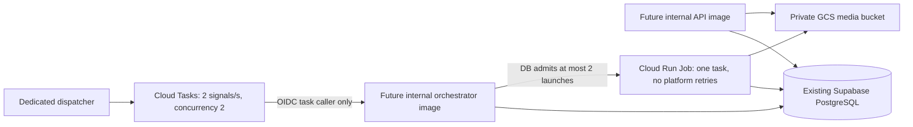

# G3A cloud infrastructure contract — Issue #6

**Decision for this component: CONDITIONAL GO for reviewable contracts and local
policy checks; NO GO for provisioning or cloud readiness.** No cloud resource,
credential, deploy, Terraform plan or apply was used. Google integrations remain
**NOT_VALIDATED**. This file describes proposals under `infra/g3a/`, not a deployed
topology. G0/G1/G2 files and Creative OS are untouched by this component.

## Validation and provenance

On 2026-11-07 the official Terraform Registry returned `hashicorp/google/8.10.0`,
published `2026-11-03T19:22:30Z`. The configuration pins exactly `= 8.10.0` and
requires Terraform `>=1.11.0,<2.0.0`. Provider resource documentation was read from
the matching official Git tag. No provider, Terraform or third-party binary was
installed or executed. Terraform/OpenTofu were absent in this environment.

| Check | Evidence/status |
| --- | --- |
| JSON parsing and local topology policy | Executed by `audit_policy.py` and tests |
| Unsafe IAM, public ingress/storage, retries, retention, resources and secrets negative fixtures | Executed; see `infra/g3a/LOCAL_POLICY_RUN.txt` |
| Terraform formatting / provider schema validation | **NOT_VALIDATED**: Terraform/provider unavailable |
| Provider lockfile and authenticated API compatibility | **NOT_VALIDATED**: provider not installed |
| Terraform remote plan / apply | **NOT_EXECUTED**: prohibited in G3A |
| GCS, Cloud Tasks, Cloud Run Jobs, Secret Manager, IAM, billing in Google Cloud | **NOT_VALIDATED**: no cloud calls/resources |
| Container build, vulnerability scan, codec distribution/license approval | **BLOCKED**: proposal only |

Reproduce the local policy evidence from a clean checkout without dependencies:

```sh
python3 infra/g3a/audit_policy.py
python3 -m unittest discover -s cloud_tests/g3a -p test_iac.py -v
```

The audit deliberately does not call Terraform or the cloud. It rejects concrete
security regressions and cannot prove provider-schema correctness, IAM effective
permissions, network reachability or runtime behavior. G3B must add an independently
reviewed Terraform/toolchain pin and provider lockfile, then run authorized
validation before any provisioning decision. Do not run `plan` or `apply` as part
of G3A reproduction.

## Guarded target topology



Two lifecycle preconditions block provisioning by default:
`staging_authorized=false` and `cloud_runtime_images_approved=false`. Every
proposed resource depends on this guard. Changing a boolean does not grant
permission: separate explicit G3B human authorization, image/security/license
review and the staging plan are required. Local state files, variable files and
plans are ignored by Git. There is no remote backend or cloud data-source lookup.

The API and orchestrator **service resources are declarative image contracts**.
Their images have no defaults and must be supplied as immutable SHA-256 digests.
The implemented local HTTP listener intentionally binds loopback only; it is not
an executable Cloud Run server. The task handler is a callable contract, also
without a deployed cloud listener. G3B must build/review the cloud HTTP adapters,
wire their secrets/configuration, correctly expose `PORT`, and validate identity,
timeouts and network ingress. No invented Python service command is included.
The dispatcher/sweep scheduler runtime is likewise not provisioned by this draft;
G3B needs explicit ownership, bounded scheduling and recovery drills.

Existing Supabase PostgreSQL is the primary data authority. This proposal creates
neither Supabase resources nor Cloud SQL. PostgreSQL still owns membership, RLS,
idempotency, outbox, reservations, retries, launch admission, leases and fencing.
Provider task names have finite retention; a signal never authorizes a render.
The new Cloud Tasks adapter intentionally has no authoritative `lookup` method,
and the unchanged G1 dispatcher is not repurposed as cloud truth.

## Identity, IAM and secret boundaries

| Workload | Scope and runtime permissions |
| --- | --- |
| API SA | Custom `storage.objects.create/get` on this bucket only; two distinct existing DB secret references for verified identity and user operations. No list, delete, update, signing or Jobs execution role. |
| Dispatcher SA | `roles/cloudtasks.enqueuer` on this queue only; `roles/iam.serviceAccountUser` on the dedicated task-caller SA only; its own existing DB secret reference. No task lookup or Jobs execution permission. |
| Task caller SA | `roles/run.invoker` on the orchestrator service only. No API invoker binding exists. |
| Cloud Tasks service agent | `roles/iam.serviceAccountUser` on the dedicated task-caller SA only, per current official instructions; principal contains the exact project number. API activation must materialize/verify its automatic `roles/cloudtasks.serviceAgent` platform grant in G3B. No manual Token Creator role is added. |
| Orchestrator SA | `roles/run.jobsExecutorWithOverrides` on the exact worker Job only; its own DB secret reference. Exact-Job `run.executions.get` custom role for terminal proof. No project-wide Jobs execution role and no job-template/IAM mutation. |
| Worker SA | Custom create/get/list/delete objects on this bucket only; its own DB secret reference. No object update, bucket admin, membership mutation or job launch role. |

Five dedicated service accounts are declared; the Google-managed Cloud Tasks
service agent is separately bound. Current Cloud Tasks documentation requires the primary service agent to have
`actAs` on the task caller and describes its automatic platform service-agent role
as the token-minting authority. Older projects that enabled the API before
2019-03-19 may require an explicitly reviewed repair. This proposal does not add
a project-wide service-agent grant or an unnecessary Token Creator role. There
are no service-account keys,
`allUsers`, `allAuthenticatedUsers`, owner/editor roles, broad project-wide runtime IAM
bindings or secret payload resources. `actAs` on the worker SA is intentionally
not granted to the orchestrator: an execution keeps the reviewed Job's fixed
service account, and overrides contain only bounded immutable identifiers. G3B
must verify effective required permissions rather than widen this grant blindly.

The reconciler also requires `run.operations.get` on a regional asynchronous
operation, whose name has no exact Job parent. Its minimal custom role is bound
to the orchestrator at the **dedicated staging project** scope, with that single
read-only permission. The controller can therefore observe operation metadata
for other Jobs in this project. This explicit visibility tradeoff avoids broad
`roles/run.developer` and includes no list, delete, update or IAM privilege. No
unsupported resource-name IAM condition is invented. The separate
`run.executions.get` permission remains bound to the exact worker Job.
Effective provider permissions and operation metadata isolation remain
**NOT_VALIDATED** until G3B. Denied GET or unknown operation holds the physical
admission slot; no real-cloud recovery success is claimed.

Secret Manager resources **already exist** in the proposed environment. Inputs
contain resource IDs and pinned numeric secret versions; distinct secret IDs are
required per DB role. No secret value, secret version payload, Supabase service
key or private signing key enters Terraform. The platform resolves secret refs at
runtime. The proposal declares which API/orchestrator env names a future adapter
must consume; those adapters are not yet implemented. Environment values do not
claim working cloud entrypoints. Never commit a real DSN, `tfvars`, plan or state.
Protect future state access even when only resource metadata is present.

IAM is bucket-scoped and does not isolate individual organizations inside the
trusted API/worker identities. Application membership checks, upload authority,
org-prefixed keys, immutable bindings and PostgreSQL RLS provide that boundary.
A compromised internal worker still has bucket-wide reconciliation permissions;
separate buckets/identities per tenant need a separate architecture decision.
The API needs access to its `<org>/uploads/<grant>/unvalidated.bin` objects and to
verified download objects, so a fictitious `staging/` prefix restriction is not
asserted. Cloud signed URL generation is not granted: the current temporary
capability/proxy contract must be cloud-reviewed before changing delivery mode.

## Storage, retention and deletion

The bucket is regional Standard, uniform-access, with enforced public access
prevention, versioning and seven-day soft deletion. `force_destroy=false` and
Terraform `prevent_destroy=true` refuse ordinary destructive teardown. Storage
cost for retained versions and soft-deleted objects must be included in G3B.
Versioning does not replace conditional creation/deletion: the GCS adapter must
use `ifGenerationMatch=0` and exact-generation conditional deletion, and PostgreSQL
must accept only its current fenced immutable manifest.

Existing object keys remain compatible with G2:

```text
<org>/uploads/<grant>/unvalidated.bin
<org>/assets/<asset>/source.mp4
<org>/assets/<asset>/caption.srt
<org>/<job>/<fence>/{vertical,square,feed}.mp4
<org>/<job>/<fence>/manifest.json
```

The only lifecycle rule aborts incomplete XML multipart uploads older than one
day. It **does not clean JSON resumable sessions**: those are provider sessions,
not partial published objects; Google documents expiration after one week.
No cloud expiry behavior was tested. The application does not expose the GCS
session URI to clients. Local receipt reconciliation and generation-fenced orphan
reconciliation remain responsible for recoverable partial operations.

`output_retention_days=30` is configurable **retention intent only**. There is no
blind age-based Delete rule: such a rule could erase current authoritative videos,
manifest or source objects while PostgreSQL still marks them valid. No `customTime`
metadata is fabricated to imply completed retention logic. G3B must implement and
test DB-aware expiration/tombstones, legal holds, download revocation, conditional
delete and receipt cleanup before enabling any output/input lifecycle deletion.
Current retained originals, uploads and versions can grow; bounded per-org upload
receipts and operation quotas do not by themselves bound lifetime cloud storage.

## Compute, concurrency and network constraints

Each worker Job has one task, parallelism one, CPU one, memory 2GiB, timeout 300s,
and `max_retries=0`. PostgreSQL owns retry/backoff and stale-worker fencing.
`engine.cloud_worker` receives only immutable `--launch-id`, `--organization-id`,
`--job-id`, `--event-id`, `--expected-fence` arguments through a validated override.
The template contains no caller arguments and only worker DSN, scratch root,
ObjectStore mode and bucket env names. The image proposal runs UID/GID10001 and
performs no package/download/build. Runtime image approval is still blocked;
Cloud Run alone is not a codec sandbox or hostile-media security assessment.

The queue caps signals at two per second and two concurrent HTTP deliveries,
with at most five attempts and 1-60s exponential backoff within 300s. Its 30s
dispatch deadline exceeds the proposed 15s service timeout. HTTP service templates
start at zero instances, cap each service at two instances and four requests per
instance, with CPU one/512MiB. Both require internal ingress and IAM checks; the
API has no runtime invoker binding. Cloud Tasks must use the same-project default
orchestrator `run.app` URI as both target and exact OIDC audience. Same-project
internal-ingress routing and effective IAM are **NOT_VALIDATED**.

Queue concurrency and Job parallelism are **not global render limits**. The
PostgreSQL launch ledger/admission controller admits at most two inflight launches
by default under a global advisory lock; uncertain submissions retain their slot
and are not retried automatically. Even a completed/failed PostgreSQL job does
not release its physical launch slot: authenticated provider execution-terminal
evidence is required; lost/unknown evidence stays blocked for operator proof. All Jobs execution IAM is restricted to the
controller identity. The local tests prove database admission, not Google Cloud
execution concurrency. G3B must verify direct launch bypass is impossible, wire
the future adapter to this controller, and reconcile cloud execution termination
before releasing uncertain slots. Per-organization active quotas remain additive.

The local upload authority stores capabilities/receipts in private SQLite and
uses a persistent private HMAC key. This is not a distributed cloud capability
ledger. Its cloud ledger migration, shared key secret reference/rotation and
multi-instance recovery are **BLOCKED** for G3B; the API image approval guard
prevents calling that cloud configuration implemented.

The HTTP implementation has its own bounded DB-connection admission semaphore;
that is not a shared cross-service pool. G3B's **initial total database connection
budget is10** for this sandbox (API4 + orchestrator2 + active workers2 + dispatcher/
sweep1 + recovery reserve1). This is a planning allocation, **not a measured hosted
Supabase pool guarantee**. G3B must measure peak/idle usage, enforce per-role limits
or an approved pooler, account for auth connections and ensure max-scaling plus
concurrent jobs cannot exceed capacity. No unconsumed `DB_POOL_SIZE` env variable
is used as evidence of a working pool.

No VPC connector, private Supabase endpoint, NAT, firewall, outbound internet
restriction or private database connection is provisioned. Internal Cloud Run
ingress does not imply private egress. Future external Supabase connections need
TLS hostname/certificate verification, approved pooler/region and measured egress;
private connectivity and cloud runtime network isolation remain **BLOCKED** until
explicit G3B design and tests. No production credential is used to test these.

## Cost controls and G3B gates

The mandatory existing billing-account reference creates only a reviewable budget
proposal, scoped to the existing sandbox project. Budget default is10 USD/month,
configurable1-100 integer USD, with current-spend alerts at50%,90%,100% sent to
billing administrators. **Budgets are delayed alerts, not spending caps or kill
switches.** Credits are included; operator billing views must separately verify
gross cost, discounts and credit exhaustion. No notification, billing account,
price or real charge was validated here. Do not interpret this value as approval
to spend. Worker-time, storage generations, API operations, logs, Supabase plan,
inter-region transfer, internet egress and idle recovery must all enter G3B cost
measurement; no fictional cost per minute is reported.

G3B must obtain explicit staging authorization and a hard operator spending/stop
policy before provisioning. Independently review provider schema/lockfile,
resource naming/ownership, auth and DB role secrets, cloud HTTP adapters, digested
images/SBOM/codecs, task OIDC issuer/audience/subject, internal routing, GCS
conditional operations, launch uncertainty/cancellation, connection caps,
observability, storage retention/restore, backup/recovery and teardown ownership.
Track the cloud tests as BLOCKED/NOT_VALIDATED until actual authorized service
responses and resource measurements are retained. The top-level G3B plan describes
the staged evidence and shutdown procedure; G3A does not execute it.

Official references read for this proposal:

- [Terraform Registry Google provider](https://registry.terraform.io/providers/hashicorp/google/8.10.0)
- [Versioned provider resource documentation](https://github.com/hashicorp/terraform-provider-google/tree/v8.10.0/website/docs/r)
- [Cloud Run restricted ingress](https://cloud.google.com/run/docs/securing/ingress)
- [Cloud Run Jobs execution roles](https://cloud.google.com/run/docs/execute/jobs)
- [Cloud Tasks authenticated HTTP targets](https://cloud.google.com/tasks/docs/creating-http-target-tasks#token)
- [GCS preconditions](https://cloud.google.com/storage/docs/request-preconditions)
- [GCS resumable uploads](https://cloud.google.com/storage/docs/resumable-uploads)
- [GCS lifecycle conditions](https://cloud.google.com/storage/docs/lifecycle)
- [Google budget alert and spend-control documentation](https://cloud.google.com/billing/docs/how-to/budgets)
