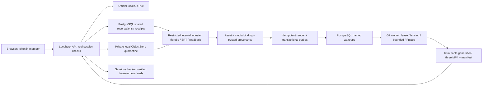

# G3B-R0: functional local browser pipeline

Scope: Issue #15, synthetic media, IPv4 loopback, disposable local PostgreSQL
and official GoTrue. This adds a local adapter; all 155 files of main
`477c7c922a8ceb0dbb1b7dca98e4b1da12fba149` remain byte-identical. Their historical
claims remain historical. `G3BR0_BASELINE_SHA256SUMS.txt` verifies that boundary.

## Trust and authority

The browser receives a real local GoTrue access token, with no refresh token,
privileged database connection or signing secret. It stores the token only in
memory. Each protected API request verifies signature, issuer, audience, role,
expiry and the actual PostgreSQL Auth session. Current membership is checked
again at the database boundary. Logout goes to GoTrue; revocation is not a
client-only UI reset. Authentication dependency exhaustion is a bounded 503,
while a genuinely invalid/revoked session remains 401.

The same-origin API rejects foreign/duplicate Host and Origin headers. It binds
only `127.0.0.1`; Auth and PostgreSQL published ports are loopback too. CSP uses
local external scripts/styles, no inline script or third-party assets. Auth
requests cannot follow redirects or environment proxies. This is a development
HTTP service without TLS, public ingress, production hardening or cloud IAM.

The PostgreSQL upload authority from G3A.1 remains authoritative across API
replicas. A receipt is still `uploaded_pending_validation`, never an asset.
The new API can request/poll ingestion through narrow SECURITY DEFINER
functions; it cannot validate, seed provenance, directly write asset tables or
assume the internal ingester role. The trusted local setup seeds an immutable
per-organization allowlist of synthetic video/SRT hash-size pairs. A checkbox,
filename, MIME type or browser-supplied metadata cannot authorize material.

The ingester checks receipt tenant/owner, current membership, approved pair,
object generation, bytes/hash, actual FFprobe video/audio/duration/format and
plain SRT. It copies to stable private immutable asset keys and reads back the
stored objects. Its final database function independently validates the binding
digest, current lease token/fence, membership and receipts, then commits asset,
media binding, provenance and completed ingestion atomically. Raw/column DML
grants on its principal are rejected at startup.

## Durable work and recovery

The UI explicitly requests a real G2 render with an immutable request key. G1
creates the job and outbox transactionally. The additive local named wakeup
adapter uses PostgreSQL; no SQLite reservation, receipt or queue is introduced
into this path. Outbox and SQL sweep recover missed deliveries. G2 remains the
render authority, with heartbeat, lease/fence, immutable output generations,
actual readback and native output verification before the final fenced commit.
An old worker cannot replace the authoritative generation.

Process death can leave a charged upload, an uncertain ingestion or an orphaned
immutable generation. This is deliberate recoverable state. Replaying the same
key does not allocate another logical operation. Lease expiry permits takeover;
stale completion is rejected. Runtime reconciliation inventories only: it does
not delete objects or refund quota. Teardown stops admissions, drains bounded
work and snapshots state. Any nonterminal/unobserved state retains private
objects, a private DB dump and stopped owned database resources for operator
reconciliation. Lost responses are recovered with stable keys and readback.

The browser fetches the committed manifest and three actual private downloads.
The API verifies the stored manifest equals PostgreSQL, verifies each output's
actual bytes/hash, and uses the existing session/membership-checked download
capabilities. The browser checks SHA-256 again before preview/save.

## Bounds and combined PostgreSQL budget

Unchanged acceptance caps: 1 MiB upload body, 120 s native job and 32 MiB per
download. The demonstration uses the existing roughly 2.3 s synthetic G0 fixture and
smoke dimensions 270×480, 320×320 and 320×400. It proves neither long-video
capacity nor production preset throughput. No quota increase is made.

| Consumer | Server login connection backstop |
| --- | ---: |
| GoTrue: configured `GOTRUE_DB_MAX_POOL_SIZE=4` | 4 |
| Shared API login, including both HTTP replicas/session checks | 6 |
| Render worker, dispatcher, queue and heartbeat | 3 |
| Internal ingester and heartbeat | 2 |
| Resource monitor | 1 |
| Total normal application consumers | 16 |

PostgreSQL has `max_connections=30`, with three superuser-reserved slots.
Transient administrative test/setup connections are separate and explicitly
outside the application budget. The API process combines all route/upload/
session consumers under a six-slot admission semaphore, with route/upload
sub-budgets of two and session sub-budget of one. Each API has four HTTP
handlers. Replicas share the server login limit of six: adding a replica does
not silently multiply the database backstop. Rejected admission is observable
backpressure, not proof of an accepted throughput target.

## Observability and limits of measurement

Fixed event categories cover authentication, pool, upload, ledger, ingest,
outbox, worker and download. Logs omit tokens, capability URLs, credentials and
caller-controlled free text. API history is bounded to 512 events in memory;
private JSONL files stop at 32 MiB. Start a fresh lab to resume a capped log;
there is no unbounded automatic rotation. Client tests separately count logical
keys, physical attempts, explicit 503, uncertain transport and exhausted retries.

The resource monitor samples actual `pg_stat_activity` by database consumer and
Linux parent/descendant RSS/live CPU every 250 ms. Summed RSS double-counts
shared pages; short-lived processes may occur between samples; container
PostgreSQL/GoTrue RSS and exited-process cumulative CPU are excluded. It is an
observation of this lab, not a machine-wide peak or cloud billing metric.
Container CPU/memory flags can be requested while unavailable rootless cgroups
prevent enforcement; that enforcement must remain NOT_VALIDATED unless proven.
Native G2 process limits and measured resources are separate evidence.

BP-02/03/04/05 remain operational backlog for remote staging. The local bounded
load, aggregate login limits, stage diagnostics and failure summaries narrow
specific gaps; they do not establish sustained production capacity, fleet-wide
pooling, complete failure analytics or cloud SLA. Hosted Auth/IAM, Cloud Run,
Cloud Tasks/GCS and real cloud costs remain NOT_VALIDATED/UNKNOWN. G3B-P1 is
NO GO. No paid service, hosted resource, deploy or Terraform plan/apply is used.
