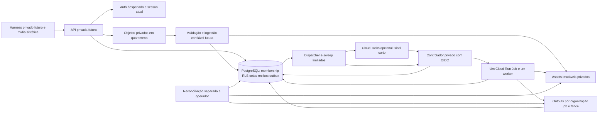

# G3B-P0 — arquitetura proposta para o primeiro ensaio cloud

Data da análise: **2026-11-07**. Este é um desenho documental, sem implantação.
`PASS` abaixo significa apenas uma constatação estática ou evidência local
identificada; execução cloud permanece `NOT_VALIDATED`.

O main auditado é `7a271382487ac4d16e278e5ccb8c345279b3cc16`. O
[PR #9](https://github.com/alterio-png/let-them-cook-content-engine/pull/9), HEAD
`e40357d08fa3c0b258b63c0d3a811cbab2b23206`, permanece **OPEN / DRAFT**. Sua
autoridade de upload PostgreSQL é uma proposta com evidência local, **não uma
capacidade integrada ao main**. Revisão independente, merge controlado, cinco
workflows aprovados no novo main e autorização humana separada são pré-condições
de qualquer G3B-P1. Região, conta, projeto, responsáveis e orçamento: `UNKNOWN`.

## 1. Topologia mínima candidata

A preferência técnica para comparar custos é aproximar API, controlador,
worker e bucket na mesma região GCP, mantendo Auth/PostgreSQL como autoridade
transacional. Não há região ou provedor aprovado por este desenho. A região do
banco pode ser diferente da região GCP; residência, latência, disponibilidade,
egress e custo das duas pontas precisam ser aprovados e medidos.

Cada caixa cloud é futura e `NOT_VALIDATED`; o componente de ingestão entre
recibo e asset não está implementado como serviço. A seta de outputs para
PostgreSQL representa verificação de bytes/manifesto e commit cercado por
lease/fence, não um evento de storage que autoriza o job.

| Camada | Candidato para o primeiro ensaio | Alternativa e trade-off | Estado atual |
| --- | --- | --- | --- |
| Auth/PostgreSQL | Supabase Auth e PostgreSQL com RLS, roles e funções estreitas | GoTrue oficial com PostgreSQL gerenciado em outro provedor, ou administrado pela equipe: mais controle de rede/residência, mas responsabilidade adicional por patch, TLS, backups, operação e custo ocioso. Não se presume que Cloud SQL inclua Auth. | Componente oficial local comprovado no PR #9; hospedagem e contratos de serviço `NOT_VALIDATED`. |
| API | Serviço Cloud Run privado, sem FFmpeg no handler | Um backend privado em VM reduz algumas camadas, mas aumenta superfície operacional e custo por tempo ligado. Nenhum listener cloud revisado existe. | Runtime cloud `BLOCKED`; listener histórico e compartilhado aceitam somente loopback. |
| Storage | GCS privado, regional Standard, próximo ao worker candidato | R2/S3 exigem implementação/revisão do mesmo contrato de criação imutável, versão/generation e delete condicional. Egress gratuito de um provedor não elimina saída cobrada pelo outro. Não trocar apenas a URL do adapter GCS. | GCS é um adapter REST testado com servidor local; GCS/R2/S3 reais `NOT_VALIDATED`. |
| Despacho | Cloud Tasks como sinal curto para o controlador | Polling/sweep PostgreSQL limitado pode bastar para baixo volume e evita fila/OIDC; exige processo/scheduler supervisionado, custo ocioso e recuperação. Nunca executar trabalho de fundo em serviço pausado após resposta sem runtime apropriado. | Contratos e sweep local existem; runtime periódico futuro `BLOCKED`. |
| Render | Cloud Run Jobs, uma execução física admitida por PostgreSQL | Uma VM privada com um worker limitado permite comparar startup, disco e utilização; exige parada explícita, patch/supervisão e preserva os mesmos leases/fences. Um host não fornece isolamento forte por tenant. | Entrypoint `engine.cloud_worker` existe; imagem, IAM, execução e custos reais `NOT_VALIDATED`. |
| Controle de custo/observação | Telemetria por operação e orçamento com alertas, operados por pessoa designada | Polling de billing e contador conservador local de consumo complementam alertas; esses mecanismos propostos não são hard caps financeiros. Não presumir habilitação de spend cap opcional oferecido pelo provedor. | Configuração efetiva, operador e latência de billing `UNKNOWN`. |

Não incluir Kubernetes, GPU, frontend, IA, publicação social, CDN, domínio
personalizado ou clientes no primeiro ensaio. A escolha entre Tasks e polling
deve ser registrada antes de pedir autorização; o desenho não contrata ambos
silenciosamente. Para avaliar Tasks, manter um sweep independente e limitado
para recuperar perda de sinais.

## 2. Fluxo de dados e fronteiras de autoridade

1. **Entrada privada e identidade dupla.** Um harness futuro autorizado alcança
   a API por uma rota privada aprovada. A identidade Google que satisfaz IAM
   do serviço não substitui a identidade do usuário. A aplicação continua
   verificando assinatura, issuer, audience, expiração, role e sessão atual do
   JWT de Auth; metadata e headers de organização não conferem membership.
   O desenho futuro deve separar o token IAM do JWT da aplicação, por exemplo
   o header de plataforma `X-Serverless-Authorization` e `Authorization` do
   usuário, com testes negativos. Isso ainda não é wiring implementado.
2. **Reserva compartilhada.** Somente após integração/revisão do PR #9,
   `SharedMediaHTTPApplication` deve selecionar `PostgresUploadAuthority` com
   login restrito, sem fallback SQLite. O banco serializa membership, cota e
   reserva; fixa owner, chave idempotente, bytes, SHA-256, objeto e expiração.
   Cada réplica futura usaria banco, store compatível e chave de assinatura
   compartilhados; o primeiro ensaio não precisa habilitar múltiplas réplicas.
3. **Quarentena.** A API recebe bytes limitados, reclama lease/fence e publica
   `<org>/uploads/<grant>/unvalidated.bin` de forma create-only. O adapter GCS
   deve usar `ifGenerationMatch=0`, verificar bytes/hash/tamanho reais e a
   generation observada antes de gravar recibo. A URI resumível GCS é segredo
   interno, não uma URL de upload para clientes. URLs assinadas diretas não
   são uma funcionalidade validada.
4. **Incerteza preservada.** Storage e PostgreSQL não compartilham commit
   atômico. Falha após claim pode deixar bytes sem recibo; manter cota e estado
   incerto, sem overwrite ou reembolso por mera ausência. Somente reserva
   expirada nunca reclamada, com fence zero, pode ser reembolsada uma vez.
   Retomada autenticada usa owner/body originais e novo fence. Objetos e recibos
   divergentes interrompem o ensaio. Prazo SQL de admissão não promete cancelar
   I/O arbitrariamente bloqueado nem limitar acknowledgement de COMMIT/fsync.
5. **Ingestão confiável — gap explícito.** Um recibo significa
   `uploaded_pending_validation`, não asset pronto. O helper G2 `ingest_media`
   usa conexão privilegiada de importador confiável e exige membership, direitos,
   snapshot, probe e SRT. Ele não consome automaticamente recibos HTTP. É
   necessário desenhar/implementar e revisar a ponte, com principal próprio,
   cópia/verificação da generation e vínculo imutável de asset. Executar o
   helper com fixture sintética pode demonstrar o componente G2; não comprova
   um pipeline upload-para-render completo. Não expor a DSN de ingestão na API.
6. **Submissão transacional.** Apenas o asset validado entra em
   `submit_media_render`; PostgreSQL retém job, fingerprint, reserva e outbox
   atomicamente. O usuário nunca fornece caminho FFmpeg, comando ou argumentos
   do worker. SQL continua a autoridade de isolamento e idempotência.
7. **Sinal e launch.** O dispatcher envia somente IDs imutáveis do outbox.
   Tasks usa identidade própria e audience exata do alvo; polling usa o mesmo
   controlador. O controlador grava intenção/token de launch antes de chamar
   `jobs.run`. Resposta perdida deixa intenção incerta, ocupa slot físico e não
   autoriza uma segunda chamada física. Deduplicação da fila é temporária e
   não é autoridade de negócio. Cinco deliveries não significam cinco renders.
8. **Worker cercado.** O único worker autorizado valida launch/org/job/event/
   fence, obtém claim PostgreSQL e mantém heartbeat. Inputs são baixados e
   verificados; FFmpeg preserva a receita G0 com áudio/SRT e três formatos,
   sob limites G2. Publicações usam `<org>/<job>/<fence>/...`; somente bytes,
   hashes, dimensões, duração, áudio e manifesto verificados permitem commit
   do fence atual. Worker antigo não pode substituir o resultado válido.
9. **Saída e recuperação.** A API entrega somente resultado autoritativo após
   reautenticação e verificação do objeto. Repetição consulta estado existente;
   falta/corrupção de resultado concluído exige reconciliação, sem rerender
   automático. `LaunchController.sweep_once` observa execução e recupera jobs
   pelo mesmo caminho de admissão; não substituir pelo sweep G2 que inicia
   workers locais fora do ledger de launches.
10. **Fechamento físico e retenção.** Job SQL concluído ou operação provider
    `done` não prova que o processo terminou. Somente observação autenticada de
    execução terminal, com identidade/counters/tempo correspondentes, fecha o
    slot físico. Upload incerto, ingestão não drenada e geração ainda válida
    ficam preservados. GC futuro exige autoridade SQL e exclusão condicional
    da generation exata. Não habilitar deleção por idade de outputs atuais.

## 3. Envelope inicial proposto, sem ativação

Estes valores são uma proposta conservadora para autorização futura e estão
`NOT_VALIDATED`. Não alteram os defaults existentes nem aprovam capacidade.
Qualquer mudança exige nova revisão de custo, segurança e ligação ao código.

| Serviço/autoridade | Primeiro P1 proposto | Limitação ou prova necessária |
| --- | --- | --- |
| API | Máximo uma instância e um request ativo; sem mínimo ocioso pretendido | Configuração cloud e limite local precisam ser compatíveis. Upload 1 MiB, JSON 16 KiB e download 32 MiB são os defaults HTTP atuais; não aumentar para caber mídia sem revisão. |
| Controlador | Uma instância, uma callback ativa; `max_inflight=1` no PostgreSQL | Semáforo/advisory lock e intenção durável continuam obrigatórios; max instances não prova ausência de overlap físico. |
| Job | Um task, parallelism um, um slot físico global; `max_retries=0` | Sem retries do provider; tentativa nova só por PostgreSQL após prova de encerramento anterior. |
| Total do ensaio | Até quatro execuções físicas cumulativas, em três jobs lógicos, dentro de uma janela de até duas horas | Dois jobs normais com fontes de 1/5 minutos; um terceiro job de 1 minuto com interrupção e recuperação pode consumir duas execuções. Um slot simultâneo não limita sozinho o total acumulado. Qualquer execução adicional exige parar e nova autorização. |
| CPU/RAM do Job | 1 vCPU / 2 GiB como primeira configuração herdada da proposta IaC | Recursos reais, memória do filesystem/scratch e picos FFmpeg precisam ser medidos. Imagem/SBOM/licença não aprovados. |
| Tempo | Timeout provider 300 s; app G2 mantém timeout de 120 s e native memory de 1 GiB atuais | Viabilidade do cenário de 5 minutos `BLOCKED` até comprovar fixture sob limites atuais. Não assumir que 300 s de vídeo cabem em 120 s de render, nem que o timeout provider eleva o limite da aplicação. A mídia sintética de 1/5 minutos tem duração diferente de wall time faturado. |
| Fila, se escolhida | 1 sinal/s, uma entrega concorrente; até cinco deliveries e backoff limitado | Proposta reduz os dois sinais/s e duas callbacks históricos. O sinal 503 é backpressure a medir; não é permissão para launch duplicado. |
| Dispatcher/sweep | Uma passagem limitada por vez; dispatcher e sweep serializados; sem scheduler presumido | Scheduler/supervisor, persistência, frequência e dono precisam de implementação/revisão. Não usar loop de background sem CPU/vida garantida. |
| Upload/reconciler | Cota administrativa por organização, TTL/lease pelo banco; um reconciler de serviço por vez | O papel de recuperação não pertence ao login HTTP. Não reembolsar uploads já reclamados ou recibos concluídos automaticamente. |
| Store | Bucket privado e generation preconditions; cap inicial compatível com HTTP/GCS/G2 | GCS tem default de leitura integral de objeto de 128 MiB e chunk 8 MiB; tamanho por objeto, readback e RAM devem ser coerentes. Versionamento/soft-delete elevam bytes retidos. |

O teste local de correção do PR #9 utilizou duas instâncias HTTP, 100 pedidos
idênticos e 20 distintos. No CI de dois CPUs houve **305 tentativas físicas,
100 respostas 201 e 205 respostas 503 recuperadas** para os duplicados. Uma
única reserva e nenhum excesso de cota foram demonstrados; throughput sustentado,
latência cloud, justiça entre tenants e escala horizontal são `NOT_VALIDATED`.
O primeiro P1 deve começar serialmente, medir saturação e só então propor uma
onda adicional, com nova autorização de limites. Não importar 100/20 como carga
cloud inicial nem aumentar retries para disfarçar saturação.

### Orçamento agregado de conexões

O número histórico dez em G3A_IAC é intenção de planejamento, não headroom
comprovado. O pool/semaforo do upload não inclui automaticamente a consulta de
sessão nem os endpoints herdados de render. O checker atual abre uma conexão
por consulta e não possui um limite global compartilhado.

Uma alocação conservadora a revisar para o envelope serial seria:

| Consumidor | Slots de aplicação propostos |
| --- | ---: |
| API: ledger de upload, incluindo heartbeat | 2 |
| API: operações de render/download herdadas | 2 |
| API: verificação de sessão atual | 1 |
| Controlador de launch | 1 |
| Dispatcher | 1 |
| Sweep de launch | 1 |
| Worker: operação principal + heartbeat | 2 |
| Reconciler de uploads | 1 |
| Operação/administração/recuperação reservada | 2 |
| Subtotal conservador de aplicação | **13** |
| Auth hospedado, serviços do provedor e conexões reservadas | **UNKNOWN, adicionais** |

Dispatcher/sweep serão serializados; contar ambos é margem conservadora, não
prova de uso simultâneo. O subtotal também separa pools que um request serial
pode não usar ao mesmo tempo. Ainda assim não é um limite atualmente imposto
por este P0: há necessidade de wiring de admission, limites por login, limites
do pooler, conexões de inicialização/health checks e controle de sobreposição de
revisões. A condição de autorização é capacidade real aprovada maior que o
pico agregado medido mais a reserva de recuperação, sem consumir conexões
reservadas pelo provedor. Se o plano não comportar isso, reduzir a alocação e
retestar ou revisar o plano; não ignorar Auth ou usar owner/service_role na API.

Não escolher pooler só pelo preço. Validar transações com `SET LOCAL ROLE`,
claims e timeouts, advisory locks transacionais, prepared statements, reconexão
e revogação entre requests. Supabase documenta restrições de transaction mode
e diferenças IPv4/IPv6; nenhum endpoint ou modo foi selecionado. Exigir
`sslmode=verify-full` e CA/hostname corretos; `require` sozinho não verifica o
servidor. Não assumir que um pooler preserve estado de sessão fora da transação.

## 4. Rede, IAM, armazenamento e dependências bloqueantes

- **Ingress não é egress.** Manter API/controlador privados com IAM; definir
  explicitamente origem do harness e rota. Acesso interno de Cloud Tasks depende
  das condições documentadas de projeto/perímetro e do URL `run.app` correto.
  Nenhuma VPC, connector, NAT, firewall, DNS privado ou rota para Supabase foi
  provisionada ou comprovada. Se rede/IPv4 add-on/NAT forem necessários, custos
  e autorização mudam antes de executar.
- **Identidades separadas.** API, dispatcher, task caller, controlador, worker,
  ingestão e reconciler usam permissões e secrets distintos. IAM de bucket
  não separa organizações dentro de um worker confiável; RLS, membership,
  prefixes e bindings imutáveis continuam necessários. Revisar o privilégio
  de list/delete do worker e a possibilidade de leitura de operações regionais;
  não ampliar para papéis administrativos para contornar um erro de integração.
- **Segredos e imagens.** Secret IDs/version refs não provam que os secrets
  existem nem autorizam criá-los. Nenhuma conta ou credencial de staging foi
  selecionada. Runtime Google/DB, assinatura compartilhada, rotação, imagem por
  digest, SBOM, FFmpeg/GPL/codecs e scanner permanecem gates bloqueantes.
- **Retenção conservadora.** Versionamento e soft-delete não substituem cópia
  de banco/restauração testada. Configuração histórica propõe sete dias de
  soft-delete e intenção de retenção de trinta dias, sem GC DB-aware completo.
  Declarar dados/versões retidos e cobrança tardia; não apagar ledger válido
  para reduzir custo. Não voltar organização ativa para SQLite vazio.

## 5. Divergência histórica que exige correção futura

[G3A_ARCHITECTURE.md](G3A_ARCHITECTURE.md),
[G3A_IAC.md](G3A_IAC.md) e `engine/cloud_http.py` descrevem SQLite como blocker
de upload distribuído. Isso continua correto para o main atual e é registro
histórico preservado. O PR #9 propõe removê-lo somente para a aplicação
compartilhada explicitamente selecionada, com PostgreSQL/local disk. Mesmo após
eventual merge, não resolve automaticamente listener cloud, ingress, hosted
session invalidation, imagem, ponte de ingestão, conexão, storage remoto, custo
e escalabilidade.

Antes de P1, um PR futuro deve revisar seleção/configuração cloud e os contratos
IaC de imagens/segredos/limites para a autoridade compartilhada. Este P0 não
reescreve documentos antigos, modifica guard booleans, migra SQLite ou fornece
um comando de deploy inventado. A matriz de autorização e o procedimento futuro
estão em [PREFLIGHT](G3B_P0_PREFLIGHT.md),
[SECURITY_GATES](G3B_P0_SECURITY_GATES.md) e
[STAGING_RUNBOOK](G3B_P0_STAGING_RUNBOOK.md).

## 6. Evidências e referências auditadas

Arquivos observados no main: `engine/cloud_http.py` (`HTTPConfig`, listener),
`engine/cloud_auth.py` (`PostgresSessionChecker`), `engine/cloud_tasks.py`
(`CloudDispatcher`), `engine/cloud_run.py` (`LaunchController.sweep_once`),
`engine/cloud_worker.py` (`run_bound_worker`, `MetadataAccessToken`),
`engine/media_runtime.py` (`Limits`), `engine/gcs_store.py` e `infra/g3a/`.
No HEAD imutável do PR #9, foram lidos
[DESIGN](https://github.com/alterio-png/let-them-cook-content-engine/blob/e40357d08fa3c0b258b63c0d3a811cbab2b23206/docs/G3A1_DESIGN.md),
[SCHEMA](https://github.com/alterio-png/let-them-cook-content-engine/blob/e40357d08fa3c0b258b63c0d3a811cbab2b23206/docs/G3A1_SCHEMA.md),
[DECISION](https://github.com/alterio-png/let-them-cook-content-engine/blob/e40357d08fa3c0b258b63c0d3a811cbab2b23206/docs/G3A1_DECISION.md),
[RUNBOOK](https://github.com/alterio-png/let-them-cook-content-engine/blob/e40357d08fa3c0b258b63c0d3a811cbab2b23206/docs/G3A1_RUNBOOK.md),
`engine/shared_upload_authority.py`, `engine/shared_upload_http.py` e a migração
`20261107150813_shared_upload_authority.sql`. O inventário SHA/checks está no
PREFLIGHT. Leitura de contratos não é um novo teste remoto.

Fontes oficiais consultadas em **2026-11-07**, apenas páginas públicas:

- [Cloud Run container contract](https://docs.cloud.google.com/run/docs/container-contract):
  serviços precisam escutar no endereço/PORT definidos pelo runtime; listener
  loopback não satisfaz esse contrato. Filesystem efêmero/memória precisam entrar
  no limite de recursos.
- [Cloud Run ingress](https://docs.cloud.google.com/run/docs/securing/ingress):
  origem/rota e IAM são camadas diferentes; a configuração não prova egress.
- [Service-to-service authentication](https://docs.cloud.google.com/run/docs/authenticating/service-to-service):
  identidade IAM por serviço e separação do token de plataforma quando a
  aplicação usa outro Authorization. Compatibilidade real `NOT_VALIDATED`.
- [Cloud Tasks HTTP targets](https://docs.cloud.google.com/tasks/docs/creating-http-target-tasks#token):
  alvo e identidade OIDC são configuração explícita; o handler recebe somente
  sinal curto e revalida a autoridade PostgreSQL.
- [GCS request preconditions](https://docs.cloud.google.com/storage/docs/request-preconditions):
  publicação create-only e deleção condicionada à geração impedem substituições
  acidentais; integridade exige também bytes reais.
- [Supabase connection methods](https://supabase.com/docs/guides/database/connecting-to-postgres):
  modos/endpoints, IPv4/IPv6, restrições de transaction mode e verificação TLS
  diferem; seleção/compatibilidade e capacidade hospedadas `NOT_VALIDATED`.

Os preços, mínimos, bytes-dia, operações, retries e egress são modelados em
[COST_MODEL](G3B_P0_COST_MODEL.md). Nenhuma tarifa transforma este desenho em
comprovação de uma conta, topologia ou crédito existente.
